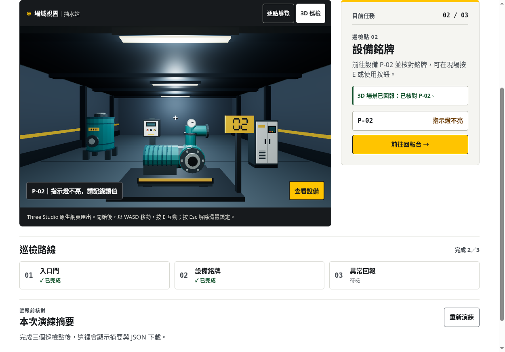

# 巡場｜3D 設施巡檢演練

給公共設施新進巡檢人員的一個短情境：走到門前、確認設備狀態、回報異常，再核對本次演練摘要。

**場域與讀值為虛構訓練資料。** 本系統不連線到設施，不收姓名，不上傳資料。此展示不替代現場安全程序。

## 體驗

```sh
python3 -m http.server 4810 --directory web
```

開啟 `http://localhost:4810/`。逐點導覽不需 GPU；可獨立走完開門、設備辨識及回報，摘要會清楚標記模式。3D 巡檢則使用 Three Studio 匯出播放器，在它的畫面先按 Play，再以方向鍵或 WASD 移動、E 互動。操作旁邊的按鈕後，再點回 3D 畫面即可繼續鍵盤移動。瀏覽器未能啟動 3D 時，改用逐點導覽；這不算通過 3D 走位或碰撞。

| 巡檢點 | 使用者要完成的工作 | 可核對的結果 |
|---|---|---|
| 01 入口門 | 靠近互動區再開門 | 站遠按鍵不觸發；門開後才能通行或繼續巡檢 |
| 02 設備銘牌 | 讀取 P-02 模擬設備與指示燈 | 摘要可追溯設備與巡檢結果 |
| 03 異常回報 | 選擇符合觀察的異常類別後完成演練 | 漏填提示；可下載有版號與模式的 JSON |

## 操作畫面



[Three Studio 編輯器 Play](docs/assets/studio-editor-play.png) · [3D 門外](docs/assets/studio-browser-01-entry.png) · [開門後](docs/assets/studio-browser-03-open.png) · [3D 設備實測](docs/assets/studio-browser-04-equipment.png) · [3D 回報與摘要](docs/assets/studio-browser-06-report.png)

[逐點導覽桌面](docs/assets/guide-desktop.png) · [手機 390 px](docs/assets/guide-390.png) · [缺項提示](docs/assets/required-feedback.png) · [回報與 JSON 摘要](docs/assets/report-desktop.png)

## 交接

- [DESIGN.md](DESIGN.md)：訓練流程、操作介面、公開案例依據與可及性設計。
- [驗收方法](docs/ACCEPTANCE.md)：將編輯器、原生匯出、門與碰撞、逐點介面分開測試；另列 [實測與限制](docs/VERIFICATION.md)。
- 用 [Three Studio 0.6.0](https://github.com/three-studio/three-studio/releases/tag/0.6.0) 開啟 `studio-project/project.json`；場景物件／碰撞在編輯器，TypeScript 只處理互動及狀態。原生 Web 匯出在 `web/runtime/`，不必在瀏覽器另外裝套件。
- [原創 GLB 與重建](art/README.md) 及 [第三方授權](licenses/README.md)。
